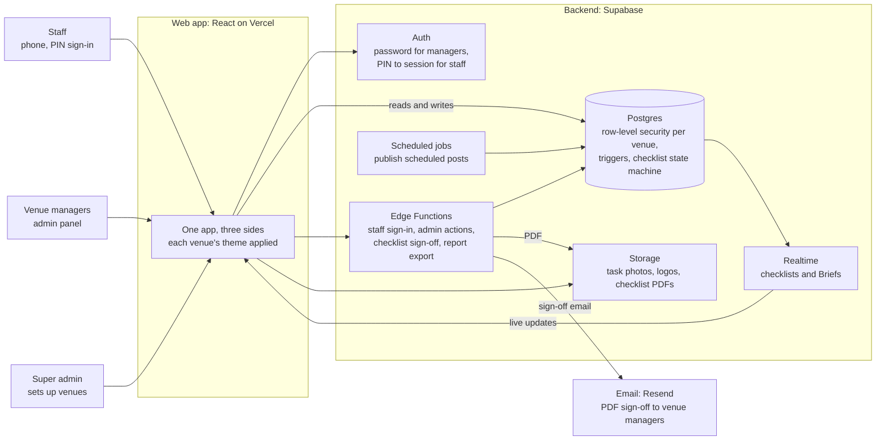

# Bar Chores

Bar staff earn points for chores and cash them in for drink tickets. Managers get photo proof, opening and closing checklists, and a PDF sign-off every time the bar opens or closes.

Live at [bar-chores.com](https://bar-chores.com).

## Why this exists

In a bar, chores are the work nobody wants. Cleaning, restocking and prep slip on a busy night, and the manager finds out the next day. A paper checklist proves nothing, and nobody is rewarded for doing it right.

Bar Chores turns that work into a points game with proof. Staff tap their name, enter a PIN and see today's tasks. Finishing a task earns points, and points buy drink or bottle tickets with a code the bartender checks. Managers approve the big tasks, run opening and closing checklists with their team, and post to per-venue message threads (called Briefs). Every checklist sign-off emails a PDF to the venue's managers.

## The five-point test

I check everything I build against five questions. They come from the five parts of every business in *The Personal MBA* by Josh Kaufman. Their real use is pointing at the part I would rather not look at.

1. **Creates and delivers something of value**
   It turns cleaning and prep into a points game with proof. Staff get a clear list and a reward; managers get photo proof for the big tasks and a PDF audit for every opening and closing.
2. **That other people want or need**
   Two groups need it, for different reasons. Staff want the reward and a clear list of what to do today. Managers need to know the work got done without standing over anyone. The buyer is the venue, and the manager answers for what got done.
3. **At a price they are willing to pay**
   This is the open part. The app is live, but the price is not set yet. My plan is to price against what a venue loses today: tasks that slip, stock that runs out, and a manager's time spent checking.
4. **In a way that satisfies the customer's needs and expectations**
   A bar floor is loud, busy and short on time. Staff tap their name and enter a PIN. It is a web app, so there is nothing to install, and updates land live with a fallback for flaky networks. It also has to be hard to game, because points change behaviour.
5. **So that it brings in enough profit to make continuing worthwhile**
   A new venue is set up in the admin, not in code, so each venue would add revenue without adding build work. Whether that is enough depends on point 3, which is still open.

## How I approached it

- **Start with who is on the floor.** Three sides share one backend: a super admin who sets up venues, venue managers who run their own venue, and staff on their phones. Each venue has its own staff, tasks, points, colours and logo, walled off from every other venue.
- **Ask how people would game it.** Tasks worth 500 points or more need a photo and a manager's approval. Points can never go below zero. When someone asks for a reward, the points are held until a manager approves, and the ticket's code is marked as used at the bar so it can't be spent twice. Nobody can hold the same task twice at once.
- **Put the rules in the database, not just on the screen.** Row-level security keeps venues apart. The checklists are a state machine the database enforces: a bar can't close before it opened, a skipped item needs a written reason before sign-off, and a closing started after midnight belongs to the night the shift opened. Even the super admin role can't read a venue's checklists or message threads.
- **Design for a busy bar, not a desk.** Large tap targets, a PIN instead of a password, and screens that update the moment you tap, then catch up with the server. Live updates have a polling fallback and retries for when the Wi-Fi drops.
- **Write it down before building it.** Each feature starts as a written design with goals and non-goals, then a step-by-step plan. One example of a non-goal: checklists earn no points, because that would upset the balance of the points game. The specs are written to hand to Claude Code one phase at a time, with a stop for review between phases. Changes go through a development environment before production.
- **Decide what to leave out.** For a guest list feature (for venues that run a door list), I mapped an existing nightlife platform feature by feature and wrote down what to build, what to skip and why. Age and gender fields stayed out: door staff would be holding personal details about members of the public with no retention policy behind them. The feature sits behind a per-venue switch, so only venues that want it see it.

## Architecture

One web app with three sides, and one backend. For everyday reads and writes the app talks to the database directly, and row-level security decides what each person can see. Anything that needs more trust runs in server-side functions: staff sign-in, admin actions, checklist sign-off and report exports.

Staff sign in with a PIN. A server function checks it and hands back a real session, so the same database rules apply to staff as to managers. The PIN is there to stop someone tapping the wrong name. It is not meant as a security gate.

## Stack

- React 19, Vite 7 and TypeScript in strict mode, with React Router
- Tailwind CSS v3, with each venue's colours applied through CSS custom properties
- Supabase: Postgres, Auth, Row Level Security, Edge Functions (Deno), Storage, Realtime and pg_cron
- pdf-lib for the PDFs, Resend for email
- Tiptap, marked and DOMPurify for the managers' Markdown composer in Briefs
- Vitest for unit tests, GitHub Actions for build, test and deploy, Vercel for hosting

## What I learned

- **The weak part was the price, not the code.** The five-point test pointed straight at it. It is easy to keep building features instead of asking someone for money.
- **A number that looks wrong costs trust.** The first completion rate on the reports page could show more than 100%, because the two halves of the sum came from different sources and time windows. I rebuilt it on one event log over one window, and removed an "average completion time" figure I couldn't measure honestly.
- **Audit early.** An early review of the whole app found admin-only powers within reach of the browser. They moved into server-side functions.
- **Keep the tests you will actually run.** End-to-end tests that needed a live database made the pipeline slow and fragile. The business rules now live in pure functions with fast unit tests, and nothing deploys unless the type check and tests pass.
- **Duplication has a running cost.** The report logic exists twice, once in the browser and once in a server function, because the two can't share code. A written rule keeps them in step. That cost is also why the guest list spec keeps its numbers off the reports page in its first version.

## What's next

Set the price and sign the first paying venue. Then turn the data the app already holds into a weekly report a manager would pay for.

## About this repo

This is a showcase — the README tells the story; the source code stays private.

If any of this helps you, take it. [Happy to talk it through](https://briannanayakkara.com/coffee/).
